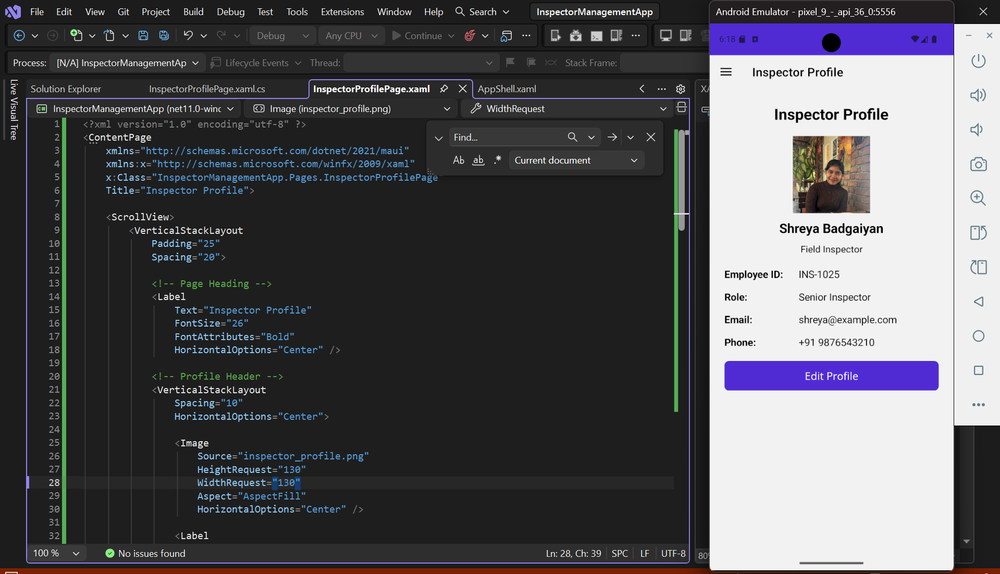

# Assignment 1

## 1. Create a new .NET MAUI application (single project). In the README, explain the project structure in your own words: which files are shared by all platforms, what the Platforms folder contains, and which file starts the app. Run the app on the Android Emulator, and on the iOS Simulator as well where a Mac is available.

### Inspector Management App

#### 1. Project Overview

Inspector Management App is a cross-platform application developed using **.NET MAUI 11, C# and XAML**.

.NET MAUI allows us to create applications for Android, iOS, macOS and Windows using a single shared project. This means we can reuse most of our code and UI across different platforms instead of creating separate projects for each operating system.

#### 2. Project Structure

This project follows the **.NET MAUI Single Project** architecture. The project is organized into shared files and folders, along with a separate Platforms folder for operating-system-specific code.

##### Shared Files

The following files are used across all supported platforms:

| File | Description |
|---|---|
| `App.xaml` | Contains application-level resources and shared styles. |
| `App.xaml.cs` | Initializes the main MAUI application instance. |
| `AppShell.xaml` | Defines the application's navigation structure. |
| `AppShell.xaml.cs` | Contains the code-behind for AppShell. |
| `MauiProgram.cs` | Configures the application, registers services and dependencies, and builds the MAUI app. |
| `GlobalUsings.cs` | Contains global namespace imports used throughout the project. |

### Shared Folders

- **Behavior:** Contains reusable UI behaviors.
- **Data:** Contains data-related classes.
- **Models:** Contains application data models.
- **PageModels:** Contains presentation logic related to application pages.
- **Pages:** Contains the different screens of the application.
- **Services:** Contains reusable services and application functionality.
- **Utilities:** Contains helper classes and utility methods.
- **Resources:** Contains shared application resources such as fonts, images, icons, splash screens and styles.

### Platforms Folder

The Platforms folder contains code and configuration specific to each operating system supported by .NET MAUI.

It contains the following folders:

| Folder | Description |
|---|---|
| `Android` | Contains Android-specific files such as MainActivity.cs, MainApplication.cs and AndroidManifest.xml. |
| `iOS` | Contains iOS-specific application startup and configuration files. |
| `MacCatalyst` | Contains files required to run the application on macOS using Mac Catalyst. |
| `Windows` | Contains Windows-specific application startup and configuration files. |

These platform-specific files allow us to handle operating-system requirements while keeping most of the application code shared.

##### Important Android Files

- **MainActivity.cs:** Defines the Android activity that hosts the MAUI application. The `MainLauncher = true` attribute identifies it as the application's launch activity.
- **MainApplication.cs:** Inherits from `MauiApplication` and initializes the MAUI application by calling `MauiProgram.CreateMauiApp()`.
- **AndroidManifest.xml:** Contains Android application settings, application icon configuration and permissions such as Internet and network-state access.

#### 3. Application Startup

The application starts through its platform-specific entry point.

For Android, the startup process works as follows:

1. `MainActivity.cs` acts as the Android launcher activity.
2. `MainApplication.cs` initializes the MAUI application.
3. `MauiProgram.cs` configures and builds the application.
4. `App.xaml.cs` creates the application instance.
5. `AppShell.xaml` defines the navigation structure and initial page.

**MauiProgram.cs** is the central configuration and application-building file, while the actual platform-specific entry point starts the application.

#### 4. Application Execution

| Configuration | Details |
|---|---|
| Framework | .NET 11 |
| Programming Language | C# |
| UI Technology | XAML |
| IDE | Visual Studio 2026 |
| Emulator | Google Pixel 9 Pro |
| Android Version | Android 16 (API 36) |

The application was successfully built and launched on the Google Pixel 9 Pro Android Emulator.

iOS Simulator testing requires a Mac with Xcode installed. It can also be performed from Visual Studio on Windows using a paired Mac.


## 2. Log a message in each application lifecycle event of your app (for example Created, Activated, Deactivated, Stopped). Run the app, press the Home button, return to it, and close it. Document in a comment block the order in which the events fired and what you would use each one for in a real app.

``` cs

using System.Diagnostics;

namespace InspectorManagementApp
{
    public partial class App : Application
    {
        public App()
        {
            InitializeComponent();
        }

        protected override Window CreateWindow(IActivationState? activationState)
        {
            Window window = new Window(new AppShell());

            window.Created += (sender, args) =>
                Debug.WriteLine("Lifecycle Event: Created");

            window.Activated += (sender, args) =>
                Debug.WriteLine("Lifecycle Event: Activated");

            window.Deactivated += (sender, args) =>
                Debug.WriteLine("Lifecycle Event: Deactivated");

            window.Stopped += (sender, args) =>
                Debug.WriteLine("Lifecycle Event: Stopped");

            window.Resumed += (sender, args) =>
                Debug.WriteLine("Lifecycle Event: Resumed");

            window.Destroying += (sender, args) =>
                Debug.WriteLine("Lifecycle Event: Destroying");

            return window;
        }
    }
}
```


## 3. Create InspectorProfilePage in XAML showing a photo (Image), name, employee ID, role, email and phone, and an Edit button. No wireframe is given, so you design the layout using VerticalStackLayout and HorizontalStackLayout.




## 4. Make sure no content is hidden behind the notch, status bar or home indicator. Document what you did to handle the safe area and why it was needed.


### Safe Area Handling

The InspectorProfilePage uses the `SafeAreaEdges="All"` property
on its ContentPage to keep the content within the device's safe
display area.

This prevents important UI elements from overlapping with:
- The status bar at the top.
- The notch or Dynamic Island on supported iPhones.
- The home indicator at the bottom.

Safe area handling is necessary because mobile devices have
different screen shapes and system UI areas. It improves content
visibility, accessibility and the overall user experience.


## 5. Create DashboardPage using a Grid: four summary cards (Total, Pending, In Progress, Completed) with hardcoded counts for now, and a 'Today's inspections' area. Show priority tags (High, Medium, Low) in a FlexLayout so that they wrap onto the next line when there is no room. In a comment, explain where you used Auto, * (star) and absolute sizes in your row and column definitions and why.


---


## 6. Test the layout in portrait and landscape and on a small and a large emulator. Nothing may be clipped or overlapping. Save before and after screenshots in a /docs folder and note what you had to change.


## 7. Create InspectionListPage using a CollectionView with at least 10 hardcoded inspections (title, site, status, scheduled date) and an ItemTemplate. Highlight the selected item. Then build the same list once using a ListView and write a short comparison: which one would you choose for a list of 1,000 items, and why?